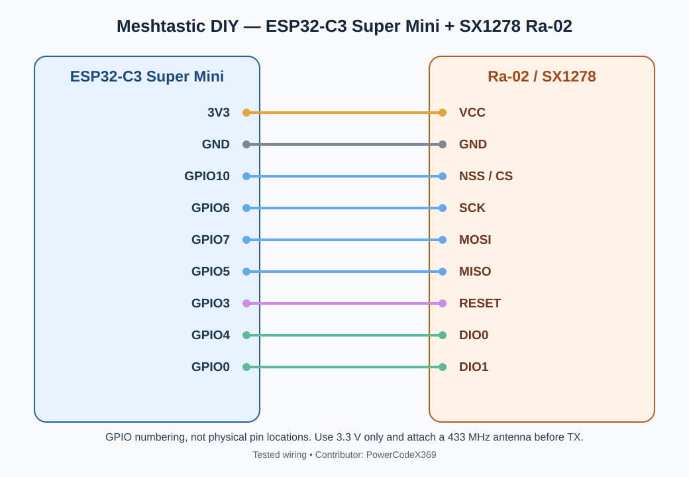

# ESP32-C3 Super Mini + SX1278 Ra-02 (433 MHz) DIY Meshtastic node

Community DIY Meshtastic firmware variant contributed by [PowerCodeX369](https://github.com/PowerCodeX369).

This variant uses an **ESP32-C3 Super Mini** and an **Ai-Thinker Ra-02 (SX1278)** LoRa radio. It is a headless device (no display or GPS in this wiring configuration) and uses the existing Meshtastic SX127x/RF95 radio path. The variant is designated `PRIVATE_HW` rather than a separately identified commercial board.

> **Hardware safety:** Use **3.3 V only** for the Ra-02 and ESP32-C3 logic. Attach a suitable 433 MHz antenna before transmitting. Radio operation and transmit power must comply with applicable local regulations. Do not connect an external 5 V supply to Ra-02 VCC.

## Hardware

- ESP32-C3 Super Mini development board (USB connector for power/programming)
- Ai-Thinker Ra-02 / SX1278 LoRa module, 433 MHz
- Suitable 433 MHz antenna and connector
- Stable 3.3 V supply, common ground, and jumper wires/PCB connections

## Wiring

| ESP32-C3 Super Mini | Ra-02 / SX1278 | Purpose |
| --- | --- | --- |
| 3V3 | VCC | 3.3 V power |
| GND | GND | Common ground |
| GPIO10 | NSS / CS | SPI chip select |
| GPIO6 | SCK | SPI clock |
| GPIO7 | MOSI | SPI data to radio |
| GPIO5 | MISO | SPI data from radio |
| GPIO3 | RESET / RST | Radio reset |
| GPIO4 | DIO0 | Radio interrupt |
| GPIO0 | DIO1 | Radio interrupt |



**Note:** The table lists ESP32-C3 **GPIO numbers**, not physical board-header positions. Check your board's silkscreen and its pinout for the particular Super Mini revision before wiring. GPIO0 also has boot-related behavior on some ESP32-C3 designs; this exact tested wiring uses it for DIO1.

## Build

From the Meshtastic firmware repository root, with PlatformIO installed and the firmware's build dependencies available:

```sh
pio run -e esp32c3_supermini_ra02_pow
```

The environment is declared in `platformio.ini`, and `platformio.ini` is discovered through the firmware's `variants/*/*/diy/*/platformio.ini` configuration glob.

For flashing, follow the standard Meshtastic ESP32-C3 flashing process and verify your USB serial device path. The `factory.bin` file includes the bootloader and partitions; do not write an application-only `.bin` at flash offset `0x0`.

## Configuration

After flashing, connect using a compatible Meshtastic client over USB serial or Bluetooth. Configure an appropriate legally permitted radio region, and use matching channel keys and modem presets on nodes intended to communicate. A channel with a shared private key is needed for private group messaging; the default public channel key is not private.

## Validation

Two physically assembled nodes were tested with the custom Meshtastic **v2.8.3** build:

- Successful firmware compilation and flashing
- USB serial and Bluetooth app connectivity
- LoRa node discovery
- Bidirectional text messaging
- Traceroute between nodes
- Reliable operation in the contributor's local tests

The same hardware variant has also been **compiled successfully against the upstream `develop` revision checked during contribution preparation**. These tests do not imply that every board revision has been physically validated or that the newer `develop` build has been flashed and field-tested.

## Contribution and support

Contributor: [PowerCodeX369](https://github.com/PowerCodeX369)

This is a community DIY variant; inclusion in an official release or hardware support listing is subject to Meshtastic maintainer review. This variant does not introduce a new mesh protocol or modify Meshtastic encryption.
